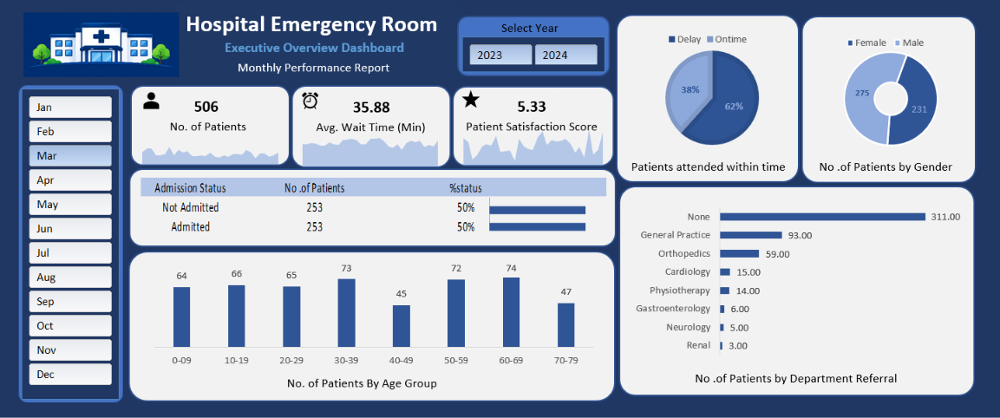

# 🏥 Hospital Emergency Room Analytics Dashboard

## 📌 Project Overview

The **Hospital Emergency Room Analytics Dashboard** is an interactive Microsoft Excel 2019 project developed to analyze patient visits, waiting times, satisfaction scores, admission status, demographics, and department referrals.

It brings important healthcare performance indicators (KPIs) and visualizations together in an interactive dashboard to support data-driven understanding of emergency room operations.

## 🎯 Project Objectives

- Analyze overall emergency room patient visits.
- Monitor average patient waiting time.
- Understand patient admission patterns.
- Analyze patient satisfaction scores.
- Explore patient demographics by age group and gender.
- Examine patient referrals across hospital departments.
- Compare patient attendance performance.
- Explore hospital data interactively using slicers.

## 🛠️ Tools & Technologies

- Microsoft Excel 2019
- Power Query
- Power Pivot
- Data Analysis Expressions (DAX)
- PivotTables
- PivotCharts
- Interactive slicers
- Data visualization

## 📈 Key Performance Indicators (KPIs)

The dashboard includes:

- **Total Patients** — measures the overall number of recorded patient visits.
- **Average Waiting Time** — shows the average time patients wait before being attended.
- **Patient Satisfaction Score** — represents the average patient satisfaction rating.

## 📊 Dashboard Features

**1. Admission Status**

Compares admitted and non-admitted patients to understand patient admission patterns.

**2. Patient Attendance Analysis**

Compares patients attended on time with those who experienced delays.

**3. Age Group Distribution**

Displays the distribution of patients across different age groups.

**4. Gender Distribution**

Shows the distribution of male and female patients.

**5. Department Referrals**

Displays patient referrals across different hospital departments.

**6. Interactive Filters**

Allows users to explore dashboard information using slicers for:

- Year
- Month

## 🖼️ Dashboard Preview

**Executive Overview Dashboard**

## 🔍 Analysis Workflow

1. Imported and reviewed the hospital emergency room dataset.
2. Cleaned and transformed the data using Power Query.
3. Organized the data model using Power Pivot.
4. Created calculated measures using DAX.
5. Summarized patient information using PivotTables.
6. Developed PivotCharts to visualize important metrics.
7. Created KPI cards and interactive slicers.
8. Organized the visualizations into an interactive Executive Overview Dashboard.

## 💡 Project Value

This dashboard provides a consolidated view of emergency room activity and helps users understand patient volume, waiting times, admission patterns, satisfaction levels, and department referrals.

It demonstrates how healthcare data can be organized and visualized to support operational monitoring and data-driven analysis.

## 📂 Project Files

- `Hospital_Emergency_Room_Analytics_Dashboard.xlsx` — Excel workbook containing the dashboard and analysis.
- `Dashboard.png` — Screenshot of the Executive Overview Dashboard.

## 📚 Dataset Source

The project dataset was sourced from the following repository:

[Hospital Emergency Room Dashboard – Satish Dhawale](https://github.com/SatishDhawale/Hospital_Emergency_Room_Dashboard)

The original dataset is not included in this repository.

## 🚀 Skills Demonstrated

- Microsoft Excel
- Data cleaning and transformation
- Power Query
- Power Pivot and data modeling
- DAX calculations
- Data analysis and summarization
- KPI development and reporting
- PivotTables and PivotCharts
- Interactive dashboard development
- Healthcare data visualization

## 📌 Future Improvements

- Develop a Patient Demographics Dashboard.
- Create an Operational Analysis Dashboard.
- Expand patient demographic analysis.
- Analyze waiting-time and operational performance trends.
- Add further insights and recommendations based on the analysis.

---

**Project Category:** Data Analytics | Healthcare Analytics  
**Tool:** Microsoft Excel 2019  
**Project Status:** Work in Progress  
**Created by:** Gorre Ashritha
